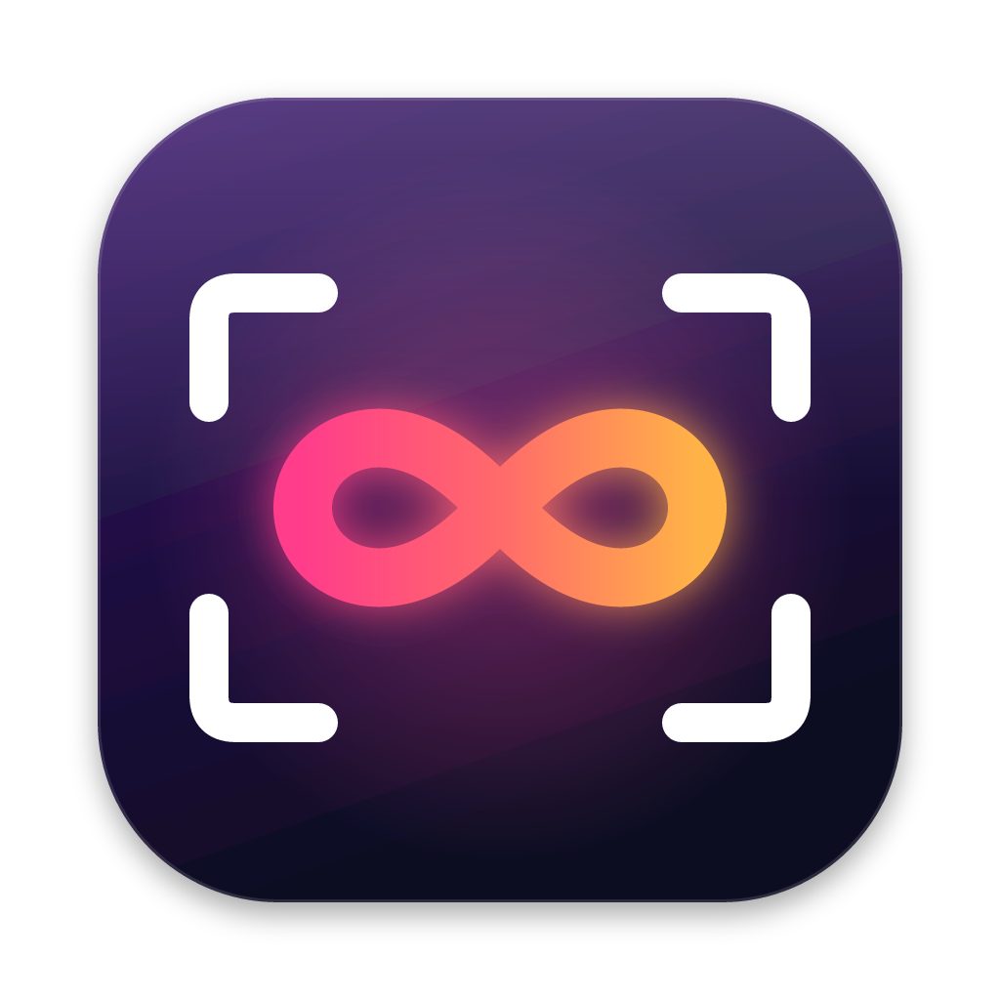

# InfiShot

用 Go 和 [MyGo](https://github.com/egoist/mygo) 写的轻量截图工具，常驻菜单栏，提供截图、标注、贴图和文字识别（OCR）。

- 纯 Go，不用 cgo（`CGO_ENABLED=0` 可以编译），界面由 MyGo 原生 UI 在 GPU 上绘制，不依赖 WebView。
- 打包后的 `.app` 约 10 MB，dmg 约 3 MB。
- 文字识别调用系统自带的 Vision 引擎，支持简体中文、繁体中文和英文，完全离线，不内置模型。
- 截图、贴图和导出的 PNG 与屏幕上看到的逐像素一致：按显示器的色彩配置转换到 sRGB，Retina 屏上不做任何缩放。

> 目前只实现了 macOS（需要 macOS 13 及以上，中文 OCR 依赖这个版本）。Windows 和 Linux 可以编译，但截图和 OCR 会提示“不支持”。

## 功能

### 截图 `⌃⌘A`

截取鼠标所在的显示器，然后在上面框选区域：

| 操作 | 效果 |
| --- | --- |
| 移动鼠标 | 自动识别光标下的内容：按钮、图标、文字、输入框、面板等窗口里的小元素，没有时识别窗口（菜单栏也可以）；放大镜显示像素坐标和颜色值 |
| 滚轮 | 向上切换到包含它的更大元素，一直到整个窗口、整个屏幕；向下回到更小的元素 |
| 单击 | 选中高亮的元素或窗口；点在桌面上则选中整个屏幕 |
| 拖动 | 框选任意区域 |
| 拖动选区边缘或角 / 拖动选区内部 | 调整大小 / 移动选区 |
| 拖动时靠近窗口、屏幕或内容元素的边缘 | 选区边缘自动吸附过去；按住 `⌥` 拖动则不吸附 |
| `←↑→↓` / `⇧` + 方向键 | 选区移动 1 pt / 选区放大或缩小 1 pt |
| 双击选区、`↩` 或 `⌘C` | 复制到剪贴板 |
| `⌘S` | 保存为 PNG |
| `⌘T` | 贴图 |
| `⌘O` | 识别文字 |
| 右键 | 放下当前工具；没有工具时取消选区（已有标注时保留选区）；没有选区时退出截图 |
| `Esc` | 退出截图 |

还没有选区时，`⌘T`、`⌘C`、`↩`、`⌘S`、`⌘O` 作用于当前高亮的窗口（或整个屏幕），例如截图时把鼠标移到某个窗口上按 `⌘T`，就能直接把它贴在屏幕上。

### 标注

框选后，工具栏左侧是标注工具，选中工具后在选区里拖动即可绘制，工具栏下方会出现粗细和颜色选择。再点一次当前工具（或右键）回到调整选区的状态。

| 工具 | 快捷键 | 说明 |
| --- | --- | --- |
| 矩形 | `R` | 按住 `⇧` 画正方形 |
| 椭圆 | `E` | 按住 `⇧` 画圆 |
| 箭头 | `A` | 按住 `⇧` 以 45° 为单位对齐 |
| 画笔 | `P` | 自由绘制 |
| 荧光笔 | `M` | 半透明的粗笔 |
| 马赛克 | `X` | 框选区域打码，粗细决定格子大小 |
| 文字 | `T` | 单击放置，输入后按 `↩`、`Esc` 或点击别处完成 |
| 撤销 | `⌘Z` | 撤销上一个标注 |

复制、保存、贴图和识别文字都会带上标注。已有标注时，在选区外按下鼠标不会重新框选，以免丢掉标注；仍可拖动选区边缘调整范围。

### 截图并识别文字 `⌃⇧O`

框选完成后直接识别文字，不再显示工具栏。识别结果窗口里的文字可以编辑，也可以一键全部复制。

### 贴图

截图时选「贴图」，或者用 `⌃⇧V` 把剪贴板里的图片贴出来。贴图会悬浮在所有窗口之上，包括全屏应用，所有桌面空间都能看到。

贴图出现后会在后台识别图中的文字（第一次识别需要十几秒加载系统模型，之后几百毫秒），识别完成时提示「可以直接选择文字」。之后可以像在文档里一样选择文字：鼠标移到文字上会变成文本光标，在文字上拖动是选择，在空白处拖动仍是移动贴图。

| 操作 | 效果 |
| --- | --- |
| 拖动空白处 | 移动 |
| 在文字上拖动 / 双击文字 / `⌘A` | 选择文字 / 选中整行 / 全选文字 |
| 滚轮或触控板双指捏合 | 以光标为中心缩放（10%–800%） |
| `⌥` + 滚轮 | 调整不透明度 |
| `⌘0` / `⌘=` / `⌘-` | 恢复原始大小 / 放大 / 缩小 |
| `⌘C` | 有选中的文字时复制文字，否则复制图片 |
| `⌘S` / `⌘O` | 另存为 / 在窗口中识别文字 |
| 双击空白处、`Esc` 或 `⌘W` | 关闭（有选中的文字时 `Esc` 先取消选择） |
| 右键 | 菜单：复制文字或图片、复制全部文字、不透明度、关闭所有贴图等 |

### 命令行

InfiShot 已经在运行时，下面的命令会交给运行中的实例执行，方便接入 Raycast、Alfred 或快捷指令：

```sh
infishot capture   # 截图
infishot ocr       # 截图并识别文字
infishot pin       # 剪贴板贴图
```

## 配置

托盘菜单里的「打开配置文件…」会打开 `~/Library/Application Support/InfiShot/config.json`，修改后重启生效：

```json
{
  "captureShortcut": "Cmd+Ctrl+A",
  "ocrShortcut": "Ctrl+Shift+O",
  "pinClipboardShortcut": "Ctrl+Shift+V",
  "saveDir": "",
  "ocrLanguages": ["zh-Hans", "zh-Hant", "en-US"],
  "ocrAutoCopy": false,
  "pinSelectText": true,
  "snap": true
}
```

- 快捷键使用 MyGo 的写法，例如 `CmdOrCtrl+Shift+2`、`Alt+F1`；留空表示不注册这个快捷键。被其他应用占用的快捷键会在启动时提示。
- `saveDir` 是保存对话框默认打开的文件夹，留空时为 `~/Pictures/InfiShot`。
- `ocrAutoCopy` 设为 `true` 后，识别完成会自动把文字复制到剪贴板。
- `pinSelectText` 设为 `false` 后，贴图不再识别文字，也就不能直接选择文字。
- `snap` 设为 `false` 后，不再识别窗口里的内容元素（悬停只识别窗口），拖动选区时也不再吸附。

## 权限

截图需要「屏幕录制」权限。第一次打开 InfiShot 时会显示欢迎窗口，先完成授权，授权前不能截图：

1. 点「前往授权」，系统会弹出授权框并打开 系统设置 › 隐私与安全性 › 屏幕与系统录音。
2. 打开 InfiShot 的开关；列表里没有时，把系统设置下方面板中的图标拖进列表。
3. 欢迎窗口检测到授权后，点「重新打开 InfiShot」。macOS 只在应用重新启动后才让它使用新授予的权限。

之后每次启动如果发现权限被关掉，欢迎窗口会再次出现。

系统按签名识别应用。用 `scripts/build.sh` 打包的版本都用同一张本地证书签名，更新后授权依然有效；直接 `go tool mygo build` 打出的是临时签名（ad-hoc），每次编译都会被当成新应用，需要重新授权。

## 开发

需要 Go 1.27.3 及以上。

```sh
go run .                 # 运行（开发时屏幕录制权限归属于启动它的终端）
go tool mygo dev         # 修改代码后自动重启
go test ./...            # 单元测试，以及不开窗口的视图测试
INFISHOT_CAPTURE=1 go test ./internal/capture   # 真实截屏，需要桌面会话
go tool mygo build       # 打包为 build/darwin-arm64/InfiShot.app 和 .dmg（临时签名）
```

### 签名打包

```sh
scripts/setup-signing.sh   # 只需一次：创建本地签名证书
scripts/build.sh           # 用这张证书签名打包
scripts/build.sh -i        # 打包后安装到 /Applications 并重新打开
```

- 证书是自签名的「InfiShot Local Signing」，有效期 10 年，只用于本机，让每次构建的签名保持一致，系统的屏幕录制授权因此不会失效。它不能用来分发给别人（那需要 Apple 的 Developer ID 和公证）。
- 证书放在单独的钥匙串 `~/Library/Keychains/infishot-signing.keychain-db` 里，钥匙串的随机密码存在登录钥匙串的「InfiShot 签名钥匙串」条目中，`build.sh` 用它自动解锁，打包时不会弹窗，也不需要把证书设为受信任。
- 签名开启了 hardened runtime，并向 Apple 请求时间戳，所以打包时需要联网。
- 不再需要时，可以删除这个钥匙串（`security delete-keychain ~/Library/Keychains/infishot-signing.keychain-db`）和登录钥匙串里的对应条目。

端到端测试：用 `go build -tags e2e` 编译，启动时设置 `MYGO_AUTOMATION=<socket 路径>`，然后用 MyGo 的 `mygo-automation` 驱动应用。

### 发布

推送 `v*` 标签会触发 GitHub Actions（`.github/workflows/release.yml`）在 macOS ARM64 环境下运行检查、打包并自动创建 GitHub Release，上传 `.dmg` 和 `.app` 压缩包：

1. 修改 `mygo.json` 中的 `version`（例如改为 `"0.1.1"`）并提交。
2. 打上对应的标签并推送：

   ```sh
   git tag v0.1.1
   git push origin v0.1.1
   ```

CI 会校验标签版本号（去掉开头的 `v`）是否与 `mygo.json` 中的 `version` 一致，不一致时构建会失败；也可以在 GitHub Actions 页面手动触发 `workflow_dispatch` 进行打包验证（不会创建 Release）。

Release 中的安装包采用临时签名（ad-hoc），未经过 Apple 公证，首次打开时会被系统拦截，需要手动放行：右键点击 `InfiShot.app` 选择「打开」，或在 系统设置 › 隐私与安全性 中点击「仍要打开」。另见上文「权限」一节，临时签名版本每次更新后需要重新授予屏幕录制权限。

### 代码结构

| 文件 | 内容 |
| --- | --- |
| `main.go` | 入口、单实例、命令行、托盘图标 |
| `app.go` | 全局快捷键、托盘菜单、截图/复制/保存流程 |
| `welcome.go` | 欢迎窗口：屏幕录制权限引导、快捷键说明 |
| `overlay.go` | 截图遮罩：选区、窗口识别、放大镜、工具栏、标注交互 |
| `annotate.go` | 标注的数据和绘制，以及带标注的导出 |
| `icons.go` | 工具栏图标（SVG） |
| `selection.go` | 选区的几何计算（有单元测试） |
| `snap.go` | 选区边缘吸附：窗口露出的边缘，以及截图中颜色突变的直线边 |
| `elements.go` | 从截图像素中识别内容元素：纯色区域（面板、按钮、输入框）和细节聚集处（图标、单词、文字行、图片） |
| `pin.go` | 贴图窗口 |
| `textsel.go` | 贴图中识别出的文字的选择：按阅读顺序排列、命中测试、选区文字和高亮 |
| `ocrwin.go` | 识别结果窗口 |
| `config.go` | 配置文件 |
| `internal/capture` | 截屏（调用系统 `screencapture -D`）、带色彩管理的解码（ImageIO）和窗口列表（`CGWindowListCopyWindowInfo`） |
| `internal/ocr` | 通过 Vision 的 `VNRecognizeTextRequest` 做文字识别，并按阅读顺序拼接 |
| `internal/macos` | 用 purego 调 Objective-C 的辅助函数 |
| `scripts/` | 本地签名证书的创建和签名打包脚本 |

### 实现说明

- **截屏**：用系统自带的 `/usr/sbin/screencapture` 截整个显示器。CoreGraphics 的截屏函数从 macOS 15 起已废弃；ScreenCaptureKit 需要 block 回调，不用 cgo 很难调用。`screencapture` 的 `-R` 参数不接受负坐标（位于主屏左侧或上方的显示器就是负坐标），所以按显示器序号截取，序号通过 `CGGetActiveDisplayList` 对应。
- **色彩**：`screencapture` 的 PNG 带有显示器的色彩配置（内置屏是 Display P3，外接屏各不相同），而 MyGo 按 sRGB 显示位图。解码时用 ImageIO 和 CoreGraphics 把像素转换到 sRGB，导出的 PNG 也标记为 sRGB，所以截图界面、贴图和导出的图片都和屏幕一致。
- **清晰度**：完成截图时选区对齐到整点，Retina 屏上截出的图片正好是选区的 2 倍像素，贴图窗口按 1:1 显示，不会因为半个像素的差别被缩放发虚。
- **内容识别**：遮罩出现后在后台分析截图（全屏约 60 ms，完成前只识别窗口）。截图按 1 pt 一格划分，相邻像素有颜色变化的格子算作边缘。不含边缘、连成一片的格子是一块纯色区域，例如面板、按钮、输入框；边缘格子按 1 pt 和 4 pt 两档间距连成团，分别对应单词或图标、文字行或一组内容。悬停时取光标所在窗口里包住光标的元素，四周各留 6 pt 空白（不超出窗口），按面积从小到大排成一串，滚轮在其中切换。系统的辅助功能接口也能拿到元素位置，但需要额外授权，所以这里只分析图像。
- **边缘吸附**：吸附目标有三类。一是窗口和屏幕的边缘，来自窗口列表，被前面窗口挡住的部分不算；二是识别出的内容元素的边；三是截图里的内容边缘，在拖动的边附近 6 pt 内逐列（或逐行）比较相邻像素，选区跨度内有六成以上明显变色的那条线才算，所以面板、按钮、图片的边会吸附，文字和照片一般不会。几类目标都在 6 pt 内时取最近的一条。
- **标注导出**：用 MyGo 的 CPU 渲染器（`ui.Render`）按截图分辨率重画一遍，和截图界面用的是同一套绘制代码；底图像素保持不变。
- **遮罩层级和位置**：MyGo 置顶窗口的层级会被菜单栏和 Dock 盖住，遮罩取到 `NSWindow` 后把层级设成屏保级。MyGo 的无边框窗口带有隐藏的标题栏，AppKit 会把这类窗口挤到菜单栏下面（带刘海的屏幕上即使是屏保级也会），所以替换了面板窗口类的 `constrainFrameRect:toScreen:`，让遮罩和贴图能放在任何位置。这个替换只在 Apple 芯片上生效。
- **贴图选字**：Vision 能准确给出每一行的位置，但它给的逐字符位置偏差较大（英文字母偏宽、汉字偏窄）。所以每个字符的位置改用系统字体排版这一行（`ui.ShapeText`）得到的字宽比例，在 Vision 的行框内分配。截图中的文字多数是系统字体或宽度相近的字体，实测与字形墨迹的偏差在几个像素以内。
- **OCR 首次较慢**：新安装或更新后，第一次识别时系统要加载并编译模型，需要十几秒（界面会有提示），之后每次只要几百毫秒。识别后进程内存会增加约 100 MB，这部分是系统模型占用的。
